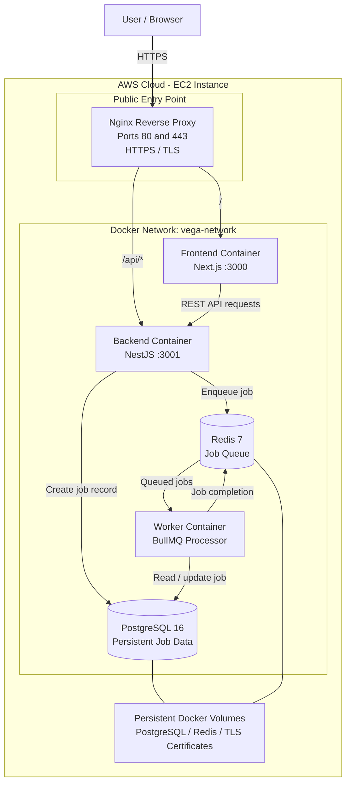
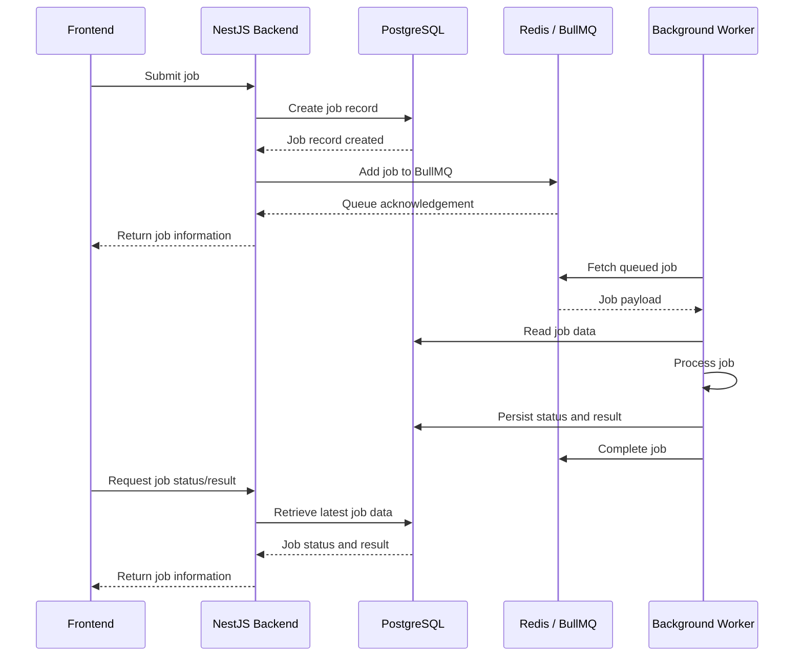
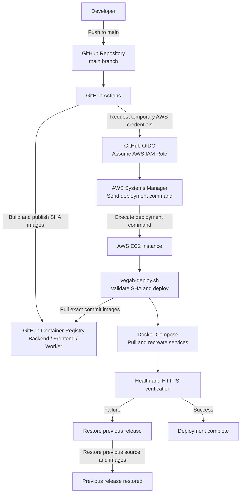
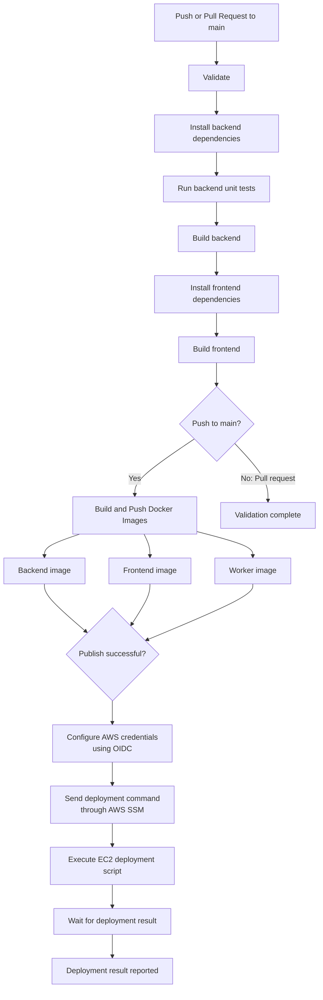

# VEGAH Cloud Platform

A containerized asynchronous job-processing platform built with **Next.js, NestJS, PostgreSQL, Redis, and BullMQ**. It provides a web interface and REST API for submitting jobs, while a dedicated background worker processes queued jobs asynchronously.

The platform is deployed on AWS EC2 using Docker Compose, Nginx, HTTPS, GitHub Container Registry (GHCR), and GitHub Actions CI/CD.

---

## Table of Contents

- [Features](#features)
- [Technology Stack](#technology-stack)
- [System Architecture](#system-architecture)
- [Asynchronous Job Processing](#asynchronous-job-processing)
- [Repository Structure](#repository-structure)
- [Local Development](#local-development)
- [Docker Configuration](#docker-configuration)
- [Production Deployment](#production-deployment)
- [CI/CD Pipeline](#cicd-pipeline)
- [Deployment Reliability and Rollback](#deployment-reliability-and-rollback)
- [Networking and Security](#networking-and-security)
- [Health Checks and Verification](#health-checks-and-verification)
- [Environment Variables](#environment-variables)
- [Useful Commands](#useful-commands)

---

## Features

- **Asynchronous job processing:** Jobs are submitted through a REST API and processed in the background using BullMQ and Redis.
- **Persistent job data:** PostgreSQL stores job records, statuses, and results.
- **Independent worker service:** Background processing runs in a separate Docker container.
- **Containerized architecture:** Frontend, backend, worker, database, and queue run as Docker services.
- **Multi-stage Docker builds:** Separate build and runtime stages reduce unnecessary build dependencies in production images.
- **Automated CI/CD:** GitHub Actions validates, builds, publishes, and deploys application images.
- **Commit-specific deployment versions:** Docker images are tagged with Git commit SHAs.
- **Cloud deployment:** Production runs on AWS EC2.
- **HTTPS reverse proxy:** Nginx handles TLS termination and routes frontend and API traffic.
- **Deployment verification:** Health checks validate application availability after deployment.
- **Rollback support:** The deployment script restores the previous release if a new deployment fails.

---

## Technology Stack

| Layer | Technology | Responsibility |
|---|---|---|
| Frontend | Next.js 16, React 19, TypeScript | Web application |
| Backend | NestJS 12, Node.js 22, TypeScript | REST API and job management |
| Background processing | NestJS worker, BullMQ | Asynchronous job execution |
| Queue | Redis 7 | Job queue and queue persistence |
| Database | PostgreSQL 16 | Persistent application and job data |
| Reverse proxy | Nginx 1.28 | Request routing and HTTPS termination |
| Containerization | Docker, Docker Compose | Application packaging and orchestration |
| Container registry | GitHub Container Registry | Docker image storage |
| CI/CD | GitHub Actions | Validation, image publishing, and deployment |
| Cloud infrastructure | AWS EC2 | Production application hosting |
| Deployment communication | AWS Systems Manager | Remote deployment command execution |
| Deployment authentication | GitHub Actions OIDC | Short-lived AWS role credentials |
| TLS certificates | Let's Encrypt | HTTPS certificates |

---

## System Architecture

### Production architecture

The production deployment consists of six Docker Compose services connected through a dedicated Docker bridge network.



### Service responsibilities

| Service | Container | Responsibility |
|---|---|---|
| Nginx | `vega-nginx` | Public HTTP/HTTPS entry point and reverse proxy |
| Frontend | `vega-frontend` | Serves the Next.js application |
| Backend | `vega-backend` | Handles API requests and job management |
| Worker | `vega-worker` | Consumes and processes queued jobs |
| PostgreSQL | `vega-postgres` | Stores persistent job data |
| Redis | `vega-redis` | Provides BullMQ queue infrastructure |

### Request routing

Nginx is the only application-facing service publishing production ports.

| Incoming path | Destination |
|---|---|
| `/` | Next.js frontend on port 3000 |
| `/api/*` | NestJS backend on port 3001 |
| `/.well-known/acme-challenge/*` over HTTP | Let's Encrypt challenge files |
| Other HTTP requests | Redirected to HTTPS |

PostgreSQL and Redis are not exposed through public host ports in the production Compose configuration. Internal services communicate using Docker service names on `vega-network`.

---

## Asynchronous Job Processing

The platform separates API request handling from background job execution.

### Job lifecycle



### Processing stages

1. The frontend submits a job through the backend REST API.
2. The backend creates a corresponding job record in PostgreSQL.
3. The backend adds the job to the BullMQ queue in Redis.
4. The worker consumes the queued job independently of the API request.
5. The worker processes the job and updates its status and result in PostgreSQL.
6. The frontend can retrieve the latest job status and result through the backend API.

**Why asynchronous processing?**

Long-running work does not need to occupy an API request for its entire execution. The backend can accept jobs and return control to the client while the worker processes them independently. Redis and BullMQ provide the queue infrastructure, while PostgreSQL provides persistent application-level job records.

---

## Repository Structure

```text
vegah-cloud-platform/
│
├── .github/
│   └── workflows/
│       └── ci-cd.yml
│
├── backend/
│   ├── src/
│   ├── test/
│   ├── Dockerfile
│   ├── package.json
│   └── package-lock.json
│
├── frontend/
│   ├── app/
│   ├── public/
│   ├── Dockerfile
│   ├── package.json
│   └── package-lock.json
│
├── worker/
│   └── Dockerfile
│
├── deploy/
│   └── nginx/
│       └── default.conf
│
├── docker-compose.yml
├── docker-compose.prod.yml
├── .dockerignore
├── .env.example
├── .gitignore
└── README.md
```

**Worker implementation:** The worker is built from the backend source code using `worker/Dockerfile`. It shares the backend's dependencies and compiled application, but runs a separate entry point (`dist/worker.js`) in its own container.

---

## Local Development

### Prerequisites

Install:

- Git
- Docker Desktop
- Docker Compose
- Node.js 22 or later (for running application components outside Docker)

### 1. Clone the repository

```powershell
git clone https://github.com/Vivek-Venugopal-Gits/vegah-cloud-platform.git

cd vegah-cloud-platform
```

### 2. Configure environment variables

Create a local environment file from the example:

```powershell
Copy-Item .env.example .env
```

Edit `.env` and configure a secure PostgreSQL password.

The local environment file must not be committed to Git.

### 3. Create the PostgreSQL Docker volume

The development Compose configuration uses an external volume named `vega_postgres_data`.

Create it before starting the services:

```powershell
docker volume create vega_postgres_data
```

### 4. Build and start the application

```powershell
docker compose up --build -d
```

### 5. Verify the running containers

```powershell
docker compose ps
```

Inspect service logs:

```powershell
docker compose logs -f
```

Or inspect an individual service:

```powershell
docker compose logs -f backend
docker compose logs -f worker
docker compose logs -f frontend
```

### 6. Access the application

| Component | Local URL |
|---|---|
| Frontend | http://localhost:3000 |
| Backend health endpoint | http://localhost:3001/api/health |
| PostgreSQL | localhost:5432 |
| Redis | localhost:6379 |

The PostgreSQL and Redis ports are published in the development Compose configuration for local development and inspection.

### 7. Stop the application

```powershell
docker compose down
```

The named PostgreSQL volume is retained when containers are stopped and removed. To intentionally delete its stored data:

```powershell
docker volume rm vega_postgres_data
```

**Warning:** Removing this volume permanently deletes the locally persisted PostgreSQL data.

---

## Docker Configuration

The repository maintains separate Compose configurations for development and production.

| Configuration | Purpose |
|---|---|
| `docker-compose.yml` | Local development using Docker builds |
| `docker-compose.prod.yml` | Production deployment using published GHCR images |

### Multi-stage builds

The backend, frontend, and worker use multi-stage Docker builds.

The build stage installs dependencies and compiles the application. The runtime stage installs production dependencies and copies the compiled output.

This keeps development/build tooling out of the final runtime image.

### Production persistent volumes

| Volume | Purpose |
|---|---|
| `vega_postgres_data` | PostgreSQL data |
| `vega_redis_data` | Redis data and AOF persistence |
| `vega_certbot_www` | ACME challenge files |
| `vega_letsencrypt` | TLS certificate storage |

Redis is configured with append-only file persistence in production.

### Production service startup

Docker Compose uses health-based startup dependencies:

- Backend waits for healthy PostgreSQL and Redis.
- Worker waits for healthy PostgreSQL, Redis, and backend.
- Frontend waits for a healthy backend.
- Nginx waits for healthy backend and frontend.

This reduces the chance of dependent services starting before their required services are ready.

---

## Production Deployment

### Infrastructure

The application is deployed on an AWS EC2 Ubuntu instance.

The production environment includes:

- AWS EC2 as the application host.
- Docker Engine and Docker Compose.
- GitHub Container Registry for application images.
- AWS Systems Manager for remote deployment execution.
- Nginx as the reverse proxy.
- Let's Encrypt TLS certificates.
- Docker bridge networking for internal service communication.
- Named Docker volumes for persistent data and certificate storage.

### Production deployment flow



### Deployment procedure

The production deployment script is installed on the EC2 instance at:

```text
/usr/local/bin/vegah-deploy.sh
```

GitHub Actions sends the target commit SHA to the instance through AWS Systems Manager.

The deployment script:

1. Validates the supplied commit SHA.
2. Prevents concurrent deployments using a file lock.
3. Checks that the working tree is clean.
4. Fetches the latest `main` branch.
5. Verifies that the target commit exists and belongs to the `main` branch history.
6. Records and validates the previous deployment state.
7. Checks out the target commit.
8. Validates the production Docker Compose configuration.
9. Pulls the backend, frontend, and worker images for the exact commit SHA.
10. Updates the application containers.
11. Verifies backend and frontend health, worker running state, image versions, and public HTTPS availability.
12. Updates the deployment state only after successful verification.

The production application is served at:

**https://vegahjobflow.duckdns.org**

The deployment process uses commit-specific image tags rather than relying on a mutable `latest` tag.

---

## CI/CD Pipeline

The CI/CD implementation is defined in:

```text
.github/workflows/ci-cd.yml
```

The workflow is triggered by:

- Pushes to `main`.
- Pull requests targeting `main`.

### Pipeline stages



### Stage 1: Validate

Runs on pushes and pull requests targeting `main`.

- Checks out the repository.
- Sets up Node.js 22.
- Installs backend dependencies using `npm ci`.
- Runs backend unit tests using `npm test`.
- Builds the NestJS backend.
- Installs frontend dependencies using `npm ci`.
- Builds the Next.js frontend.

### Stage 2: Build and publish images

Runs only after validation succeeds and only for pushes to `main`.

The workflow builds and publishes three images:

```text
ghcr.io/vivek-venugopal-gits/vegah-cloud-platform-backend
ghcr.io/vivek-venugopal-gits/vegah-cloud-platform-frontend
ghcr.io/vivek-venugopal-gits/vegah-cloud-platform-worker
```

Each image is published with two tags:

| Tag | Purpose |
|---|---|
| `latest` | Convenience tag for the most recently published build |
| Git commit SHA | Immutable release identification |

Production deployment uses the commit SHA tag.

### Stage 3: Deploy to AWS EC2

Runs only after successful image publishing.

The workflow:

1. Uses GitHub Actions OIDC to assume the configured AWS IAM role.
2. Sends the deployment command to the EC2 instance through AWS Systems Manager.
3. Passes the Git commit SHA as the deployment target.
4. Polls the SSM command status.
5. Reports deployment output when successful.
6. Reports standard output and errors and fails the workflow when deployment fails or times out.

### CI/CD security

The workflow uses:

- GitHub's built-in `GITHUB_TOKEN` for GHCR publishing.
- GitHub OIDC for AWS authentication.
- AWS IAM role-based permissions.
- AWS Systems Manager instead of SSH-based deployment from GitHub Actions.
- GitHub repository variables for non-secret deployment configuration.

No permanent AWS access key or SSH private key is required by the workflow.

Required repository variables:

| Variable | Purpose |
|---|---|
| `AWS_REGION` | AWS deployment region |
| `AWS_ROLE_TO_ASSUME` | IAM role assumed through OIDC |
| `EC2_INSTANCE_ID` | Target EC2 instance identifier |

---

## Deployment Reliability and Rollback

Production deployment is designed to avoid leaving the application on a partially deployed release.

The deployment script includes:

- Input validation for the target commit SHA.
- A deployment lock to prevent concurrent deployments.
- Clean working-tree verification.
- Validation that the requested commit belongs to `main` history.
- Exact SHA-based image selection.
- Docker Compose configuration validation.
- Post-deployment health verification.
- Previous release state tracking.
- Automatic rollback when deployment verification fails.

### Rollback procedure

If a new release fails:

1. The script restores the previous source revision.
2. It redeploys the previous release's Docker images.
3. It verifies the restored services.
4. It updates deployment state only after successful recovery.

The rollback mechanism has been tested by deliberately triggering a deployment failure and verifying that the previous release was restored.

A successful rollback restores service availability, but it does not automatically reverse database schema changes or other irreversible data modifications. Database migrations must therefore be designed with backward compatibility in mind.

---

## Networking and Security

### Production networking

- Nginx publishes ports `80` and `443`.
- Frontend and backend communicate through the internal Docker network.
- Worker communicates with Redis and PostgreSQL internally.
- PostgreSQL and Redis do not publish public host ports in production.
- HTTP traffic is redirected to HTTPS, except for the ACME challenge path.

### TLS

Nginx terminates HTTPS using Let's Encrypt certificates.

The Nginx configuration supports:

- TLS 1.2 and TLS 1.3.
- HTTP-to-HTTPS redirection.
- ACME HTTP challenge requests.
- Proxy headers for forwarding client and request information.

### Secrets management

Do not commit `.env` files or credentials to the repository.

Production credentials and environment configuration must be maintained on the deployment host with restricted filesystem permissions. GitHub Actions uses OIDC and repository variables rather than permanent AWS credentials.

---

## Health Checks and Verification

Docker Compose defines health checks for the production PostgreSQL, Redis, backend, frontend, and Nginx services.

| Service | Verification |
|---|---|
| PostgreSQL | `pg_isready` |
| Redis | `redis-cli ping` |
| Backend | HTTP request to `/api/health` |
| Frontend | HTTP request to the frontend server |
| Nginx | `nginx -t` |
| Worker | Deployment script verifies that the container is running |

### Application health endpoint

```http
GET /api/health
```

Expected response:

```json
{
  "status": "ok",
  "service": "backend",
  "timestamp": "..."
}
```

The production deployment script also verifies public HTTPS availability after updating the containers.

---

## Environment Variables

### Local development

The `.env.example` file currently defines:

| Variable | Description |
|---|---|
| `POSTGRES_USER` | PostgreSQL username |
| `POSTGRES_PASSWORD` | PostgreSQL password |
| `POSTGRES_DB` | PostgreSQL database name |

Copy `.env.example` to `.env` and provide a secure local password.

### Production

The production Compose configuration requires:

| Variable | Description |
|---|---|
| `POSTGRES_USER` | PostgreSQL username |
| `POSTGRES_PASSWORD` | PostgreSQL password |
| `POSTGRES_DB` | PostgreSQL database name |
| `FRONTEND_URL` | Public frontend origin used by the backend |
| `IMAGE_TAG` | Application release tag; supplied by the deployment process |

The backend also receives its database URL and Redis host/port through Docker Compose.

The frontend and worker receive their respective runtime settings through their Compose service definitions.

Never publish actual environment values or credentials in documentation, source control, or logs.

---

## Useful Commands

### Development

```powershell
# Start all development services
docker compose up --build -d

# List containers
docker compose ps

# Follow all logs
docker compose logs -f

# View backend logs
docker compose logs -f backend

# View worker logs
docker compose logs -f worker

# Stop development services
docker compose down
```

### Production inspection

Run these commands on the EC2 host:

```bash
# Navigate to the deployment repository
cd /opt/vegah/vegah-cloud-platform

# Inspect production services
sudo docker compose -f docker-compose.prod.yml ps

# View service logs
sudo docker compose -f docker-compose.prod.yml logs --tail=100

# Inspect individual services
sudo docker logs vega-backend
sudo docker logs vega-worker
sudo docker logs vega-frontend
sudo docker logs vega-nginx
```

### Git

```bash
# Check current branch and working tree
git status --short --branch

# Inspect recent commits
git log --oneline -10
```

---


This repository was developed as part of a cloud platform and DevOps engineering assessment.
