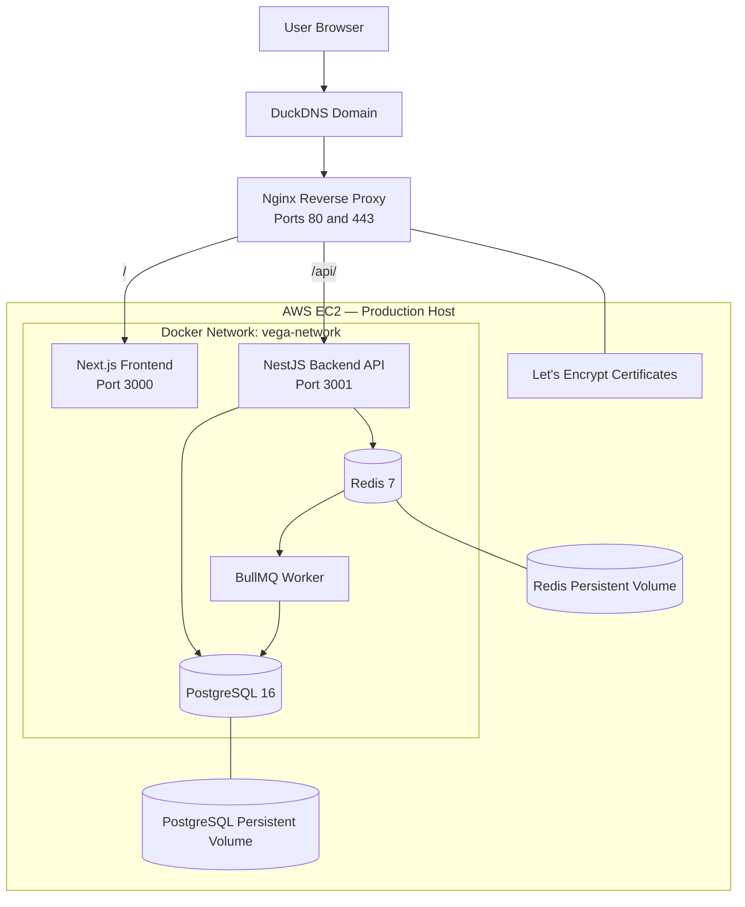
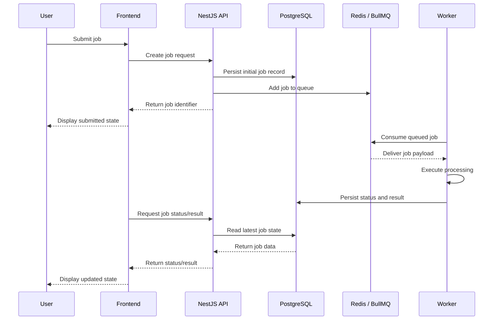
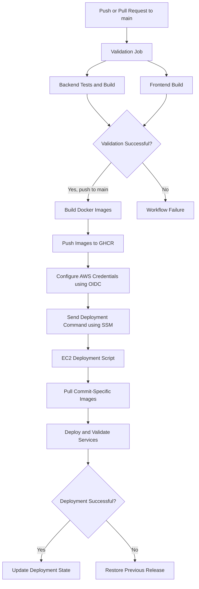

# VEGAH Cloud Platform — Architecture Document

## 1. Purpose

This document describes the architecture and operational design of the VEGAH Cloud Platform assessment implementation.

The platform demonstrates a containerized application with:
- A Next.js frontend.
- A NestJS backend API.
- A BullMQ worker for asynchronous job processing.
- PostgreSQL for persistent application and job data.
- Redis for queue management.
- Nginx as the public reverse proxy and HTTPS entry point.
- GitHub Actions for CI/CD.
- AWS EC2 and Systems Manager (SSM) for production deployment.

## 2. High-Level Production Architecture



### 2.1 Component responsibilities

| Component | Responsibility |
|---|---|
| Next.js frontend | User interface and interaction with backend APIs |
| NestJS backend | API endpoints, job creation, persistence, and status/result retrieval |
| BullMQ worker | Consumes queued jobs and executes asynchronous processing |
| PostgreSQL | Stores persistent application data and job records |
| Redis | Stores BullMQ queue state and supports asynchronous job delivery |
| Nginx | Public HTTP/HTTPS entry point and reverse proxy |
| Docker Compose | Defines and coordinates production containers |

### 2.2 Public traffic routing

The public domain is:

`https://vegahjobflow.duckdns.org`

Nginx is the only application-facing service exposing public host ports:
- Port 80 handles ACME certificate challenges and redirects other HTTP requests to HTTPS.
- Port 443 terminates HTTPS and routes requests internally.
- `/api/` is forwarded to the NestJS backend on port 3001.
- Other application requests are forwarded to the Next.js frontend on port 3000.

The backend, worker, PostgreSQL, and Redis do not publish their application ports directly to the public host in the production Compose configuration.

## 3. Asynchronous Job Processing

The platform separates job submission from job execution. The API accepts a request and queues the work rather than requiring the client to wait for processing to finish.



### 3.1 Job lifecycle

The logical lifecycle is:

1. **Submission:** The frontend sends a job request to the backend.
2. **Persistence:** The backend creates a corresponding job record in PostgreSQL.
3. **Queueing:** The backend adds the asynchronous task to BullMQ using Redis.
4. **Acknowledgement:** The backend returns a job identifier to the frontend.
5. **Consumption:** The worker retrieves queued work from Redis.
6. **Processing:** The worker executes the task.
7. **Result persistence:** The worker updates the job record with its latest status and result.
8. **Retrieval:** The frontend requests the latest job information through the backend API.

PostgreSQL is the persistent source for application job records. Redis is used for queue coordination; it is not a replacement for the application's relational data store.

## 4. Container and Network Design

Production services are defined in `docker-compose.prod.yml`.

The application containers communicate through the Docker network:

`vega-network`

### 4.1 Production services

| Service | Container name | Internal port / role |
|---|---|---|
| Frontend | `vega-frontend` | 3000 |
| Backend | `vega-backend` | 3001 |
| Worker | `vega-worker` | Background process |
| Nginx | `vega-nginx` | Public 80 and 443 |
| PostgreSQL | `vega-postgres` | 5432 |
| Redis | `vega-redis` | 6379 |

The database and Redis ports are internal to the Docker network in production. This reduces direct exposure of infrastructure services.

### 4.2 Persistent storage

| Volume | Purpose |
|---|---|
| `vega_postgres_data` | PostgreSQL database files |
| `vega_redis_data` | Redis persistence data |
| `vega_certbot_www` | ACME webroot challenge files |
| `vega_letsencrypt` | TLS certificates and related configuration |

Redis is configured with append-only persistence. PostgreSQL and Redis use named Docker volumes so their data is not tied to the lifecycle of an individual container.

Persistent volumes are not a substitute for an off-host backup strategy.

## 5. Container Build Strategy

The application uses Dockerfiles with separate build and runtime stages.

### Backend

- Uses Node.js 22 Alpine as its base image.
- Installs dependencies and builds the NestJS application.
- Installs production dependencies in the runtime stage.
- Starts the compiled application using `node dist/main.js`.

### Frontend

- Uses Node.js 22 Alpine.
- Builds the Next.js application in a build stage.
- Uses a separate runtime stage to run the production application.
- Uses `NEXT_PUBLIC_API_URL` as a build-time argument.

### Worker

- Uses the backend source and package configuration as its build context.
- Builds the backend project.
- Starts the worker process using `node dist/worker.js`.

The worker is built as a separate image so it can run independently from the HTTP API process.

## 6. Health Checks and Service Dependencies

Production Compose defines health checks for the main application and infrastructure services.

The dependency design ensures:
- Backend startup waits for healthy PostgreSQL and Redis services.
- Worker startup waits for healthy PostgreSQL, Redis, and backend services.
- Frontend startup waits for a healthy backend.
- Nginx startup waits for healthy backend and frontend services.

The deployment script additionally checks:
- Backend health.
- Frontend health.
- Worker running state.
- Expected image tags.
- Public HTTPS health endpoint.

The worker is checked for its running state by the deployment script; it does not have an equivalent Docker health check in the current implementation.

## 7. CI/CD Architecture

The CI/CD workflow is defined in:

`.github/workflows/ci-cd.yml`

It runs on pushes and pull requests targeting `main`. Publishing and deployment are restricted to pushes to `main`.



### 7.1 Validation stage

The validation job:
- Sets up Node.js 22.
- Installs backend dependencies.
- Runs backend tests.
- Builds the backend.
- Installs frontend dependencies.
- Builds the frontend.

Publishing and deployment do not proceed when the required validation job fails.

### 7.2 Image publishing stage

After successful validation on a push to `main`, the workflow:
- Authenticates to GitHub Container Registry (GHCR).
- Builds backend, frontend, and worker images.
- Pushes images tagged with the Git commit SHA.
- Also publishes the `latest` tag.

The production deployment uses the commit-specific SHA tag rather than relying on `latest`.

### 7.3 Deployment stage

After publishing, the workflow:
1. Assumes the configured AWS IAM role through GitHub Actions OIDC.
2. Sends an AWS Systems Manager command to the configured EC2 instance.
3. Invokes `/usr/local/bin/vegah-deploy.sh` with the target commit SHA.
4. Waits for the SSM command result.
5. Reports deployment success or failure.

## 8. AWS Identity and Deployment Security

The deployment uses GitHub Actions OIDC instead of storing long-lived AWS access keys in GitHub repository secrets.

The trust relationship restricts role assumption to the configured GitHub repository and `main` branch identity.

The deployment role has permissions required to:
- Send the deployment command through AWS Systems Manager.
- Retrieve the command invocation result.

The EC2 instance uses an attached IAM role with Systems Manager managed-instance permissions.

This separates GitHub's deployment identity from the EC2 instance's operational identity.

## 9. Deployment and Recovery Strategy

The EC2 deployment script is located at:

`/usr/local/bin/vegah-deploy.sh`

Its responsibilities include:

1. Validate the supplied commit SHA.
2. Prevent concurrent deployments using a lock.
3. Check that the target commit belongs to the current `main` history.
4. Verify the working tree is clean.
5. Check out the requested source revision.
6. Validate the production Compose configuration.
7. Pull the matching commit-specific application images.
8. Recreate the backend, frontend, and worker services.
9. Validate service health and public HTTPS availability.
10. Update the deployment state file only after successful validation.

### 9.1 Rollback

If a deployment fails, the script attempts to restore the previous known deployment:
- Restore the previous source revision.
- Deploy the previous commit-specific application images.
- Verify the restored services.
- Preserve the previous successful deployment state.

The rollback path has been exercised through a controlled test. The application and source were restored to the previously deployed commit successfully.

**Important limitation:** Application rollback does not automatically reverse PostgreSQL schema or data migrations. Database changes must be designed with backward compatibility and an appropriate migration/recovery strategy.

## 10. Environment Configuration

Production configuration is supplied through environment variables rather than hard-coded application credentials.

The production Compose configuration consumes:
- `POSTGRES_USER`
- `POSTGRES_PASSWORD`
- `POSTGRES_DB`
- `FRONTEND_URL`
- `IMAGE_TAG`

Database connection and Redis host/port configuration are composed for the containers by the Compose configuration.

Refer to `.env.example` for the documented configuration template. Use a separate, securely managed production environment file for real credentials. Do not commit production secrets to source control.

## 11. Operational Verification

Useful commands on the EC2 instance:

```bash
cd /opt/vegah/vegah-cloud-platform

# Inspect production services
sudo docker compose -f docker-compose.prod.yml ps

# Inspect recent logs
sudo docker compose -f docker-compose.prod.yml logs --tail=100

# Inspect individual containers
sudo docker logs vega-backend
sudo docker logs vega-worker
sudo docker logs vega-frontend
sudo docker logs vega-nginx

# Check public backend health
curl -fsS https://vegahjobflow.duckdns.org/api/health

# Inspect deployment state
sudo cat /var/lib/vegah/deployment-state
```

The deployment state file is maintained on the EC2 host and should be accessed with appropriate permissions.

## 12. Current Implementation Boundaries

The following distinctions are important when evaluating the implementation:

- The frontend, backend, worker, PostgreSQL, Redis, and Nginx are separate production services.
- The worker is a separate process and image, but it is built from the backend source and package configuration.
- PostgreSQL and Redis are not directly published to the public host in production.
- Application images are selected by commit SHA during production deployment.
- The `latest` image tag is published for convenience, but production deployment uses the requested SHA.
- The deployment script validates application health and has a tested application rollback path.
- Database schema migrations are not automatically rolled back by the deployment script.
- Persistent Docker volumes provide local persistence, not independent disaster recovery.

## 13. Assessment Evidence

The implementation evidence should include:

| Area | Evidence |
|---|---|
| Containerization | Dockerfiles and Compose configurations |
| Asynchronous processing | Backend queue integration, worker process, and job status/result flow |
| Persistence | PostgreSQL and Redis volume configuration |
| CI/CD | GitHub Actions workflow run |
| Image publishing | Commit-specific GHCR image tags |
| Cloud deployment | AWS EC2 deployment and public HTTPS endpoint |
| Secure deployment access | GitHub OIDC and AWS Systems Manager |
| Reliability | Health checks, deployment validation, and controlled rollback test |
| Documentation | Root README and this architecture document |
| Walkthrough | Screen recording demonstrating the implementation in under three minutes |

